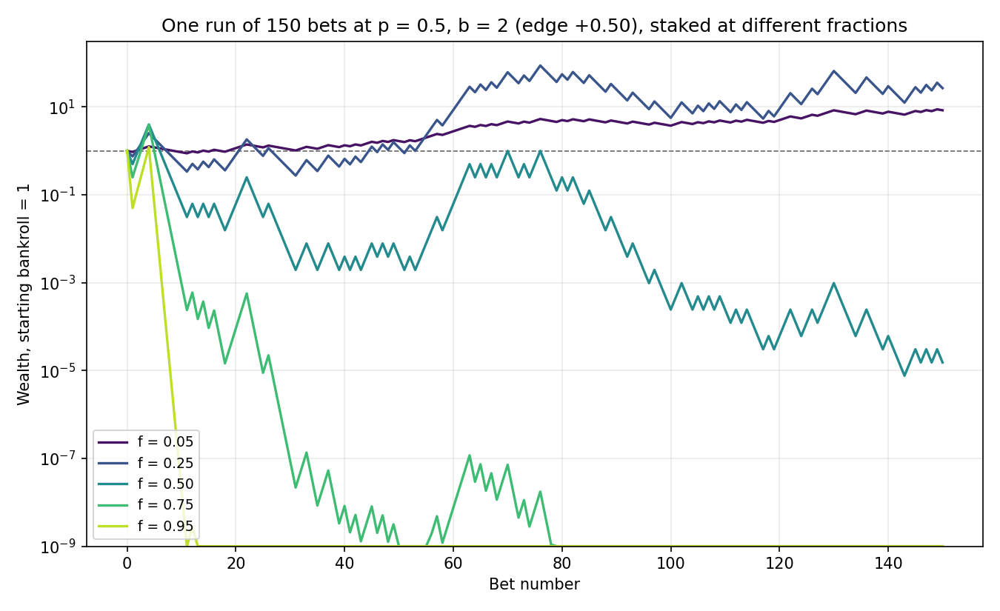

# kelly-lab

Why betting too big ruins you even when you have an edge.

With a real, positive edge, staking too large a fraction of your wealth leads to
near-certain ruin. This repo builds the simulations that show it.

The simulator works, the first chart is drawn, and the optimal stake is located by
simulation and checked against the Kelly formula. The growth curve comes next.

## Setup

```bash
python3 -m venv .venv
source .venv/bin/activate
pip install -r requirements.txt
pip install -e .
```

## The simulator

```python
from kelly.simulate import BetSpec, wealth_paths, final_log_wealth, ruin_probability

bet = BetSpec(p=0.5, b=2.0)          # a fair coin paying 2 to 1
bet.edge                             # +0.50 profit per unit staked

wealth_paths(bet, fraction=0.25, horizon=200, n_paths=5, seed=0)
final_log_wealth(bet, fraction=0.25, horizon=500, n_paths=50_000, seed=0)
ruin_probability(bet, fraction=0.80, horizon=500, n_paths=50_000, seed=0)
```

Four parameters: the win probability `p`, the net odds `b`, the fraction of wealth
staked on every bet, and the horizon. A win multiplies wealth by `1 + fraction * b`,
a loss by `1 - fraction`, and the two compose.

Everything accumulates in **log wealth**. Over a long horizon the natural scale
overflows float64 well before the simulation stops being interesting, and the sum of
logs does not. `wealth_paths` exponentiates on the way out when you want the raw
numbers.

Ruin is exact. Staking the whole bankroll turns one loss into wealth of precisely
zero, whose log is `-inf`, and the running sum keeps it there. There is no recovery
from zero and the simulator does not pretend otherwise.

## The same run, five different stakes



One run of 150 bets on the coin above, replayed at five stakes. Every curve sees the
*same* wins and the same losses, drawn once and reused, so nothing here is luck: only
the stake changes.

| Fraction | Wealth after 150 bets |
|---|---|
| 0.05 | 8.4 |
| 0.25 | 26.8 |
| 0.50 | 0.0000153 |
| 0.75 | below 1e-9 |
| 0.95 | below 1e-9 |

The bet has a +0.50 edge throughout. Staking a quarter turns the bankroll into 27
times itself; staking three quarters of it destroys the bankroll on the same run of
cards. Regenerate the figure with:

```bash
python scripts/make_wealth_paths_figure.py
```

Wealth is on a logarithmic axis, so a constant growth rate is a straight line. Paths
are floored at 1e-9 for drawing: a line resting on the bottom of the chart has lost
more than nine orders of magnitude, and at a fraction of exactly 1 it is truly zero
and never comes back.

## Verified against the closed form

Expected log growth per bet is `p·log(1+fb) + q·log(1-f)`. Simulating 50,000 paths of
500 bets reproduces it:

| Fraction | Analytic g | Simulated g | Error | Runs left with under 1% |
|---|---|---|---|---|
| 0.05 | 0.02201 | 0.02201 | 0.00000 | 0.0% |
| 0.10 | 0.03848 | 0.03849 | 0.00001 | 0.0% |
| 0.25 | 0.05889 | 0.05891 | 0.00002 | 0.0% |
| 0.40 | 0.03848 | 0.03852 | 0.00004 | 2.7% |
| 0.60 | -0.06392 | -0.06386 | 0.00006 | 93.0% |
| 0.80 | -0.32696 | -0.32688 | 0.00008 | 100.0% |
| 0.95 | -0.96551 | -0.96538 | 0.00013 | 100.0% |

Every row is the same bet with the same +0.50 edge. Only the stake changes. By 0.60
the growth rate is negative and 93% of runs have lost 99% of the bankroll, and none of
that comes from a bad bet. That is the whole thesis of the repo.

## Finding the peak without the formula

The growth rate rises, peaks, and falls, so there is one best stake. The Kelly
formula puts it at `f* = p - q/b`, which is the edge divided by the odds.

To check the formula without trusting it, `kelly.optimal.numerical_kelly_fraction`
draws 50,000 runs of 500 bets once. A golden-section search then finds the fraction
with the highest mean log growth on that draw. The search never sees the formula.

| p | b | Edge | Formula f* | Simulated f* | Error | Sampling sd | g at f* |
|---|---|---|---|---|---|---|---|
| 0.5 | 2 | +0.500 | 0.25000 | 0.25003 | +0.00003 | 0.00015 | 0.05889 |
| 0.6 | 1 | +0.200 | 0.20000 | 0.20001 | +0.00001 | 0.00020 | 0.02014 |
| 0.55 | 1 | +0.100 | 0.10000 | 0.09998 | -0.00002 | 0.00020 | 0.00501 |
| 0.3 | 4 | +0.500 | 0.12500 | 0.12498 | -0.00002 | 0.00011 | 0.02817 |
| 0.1 | 12 | +0.300 | 0.02500 | 0.02495 | -0.00005 | 0.00006 | 0.00345 |
| 0.9 | 0.2 | +0.080 | 0.40000 | 0.40026 | +0.00026 | 0.00036 | 0.01818 |

Every simulated peak is within one standard deviation of the formula. The error is
not a search error. Log wealth depends only on how many bets were won, so on a shared
draw the simulated curve is exactly the closed form with `p` replaced by the observed
win rate. Its peak moves with that win rate, with standard deviation
`(1 + 1/b)·sqrt(pq / (paths × bets))`, which is the last column. Searching the exact
curve instead recovers the formula to 1e-6 on every bet tested.

Read the first and fourth rows together. Both bets have the same +0.50 edge, yet one
should be staked at 25% and the other at 12.5%. The longshot at 12 to 1 has a bigger
edge than the 0.55 coin and deserves a quarter of its stake. Size comes from the edge
*and* the odds, never from the edge alone. Reproduce the table with:

```bash
python scripts/check_kelly_fraction.py
```

Drawing the curve itself, and the point where it crosses back below zero despite the
edge, is the next step in [TODO.md](TODO.md).

## Speed

The win count over a horizon is binomial, so a final wealth only needs one draw per
path rather than one per bet. Same distribution, and for 50,000 paths of 500 bets:

| | |
|---|---|
| `final_log_wealth`, binomial | 6.2 ms |
| `simulate_log_paths`, full history | 3.3 s |

Use the full paths when the shape of the path is the thing being plotted, and the fast
one for sweeps.

## Run the tests

```bash
pytest
```

106 tests. The deterministic ones pin the mechanics: a certain win compounds at
exactly `1 + fb`, wealth only ever moves by one of two factors, ruin never recovers,
the growth rate's derivative vanishes at the Kelly fraction. The statistical ones run
on a fixed seed: the simulator against the closed form, and the simulated optimum
against the formula within six standard deviations of its sampling error. The
chart tests read the data back off the axes and check it against the simulator, so a
figure cannot drift away from what it claims to draw.

Roadmap and progress: [TODO.md](TODO.md)
